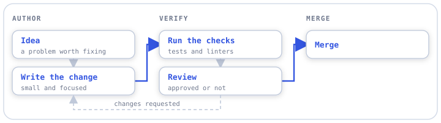
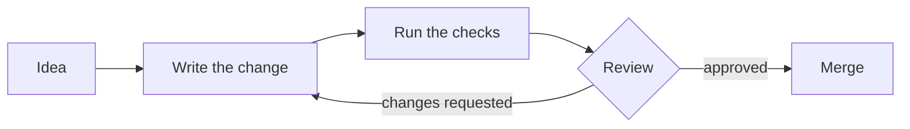

<!-- GENERATED FILE - DO NOT EDIT.
     Produced by `show-your-work render` from intro.md, the .mmd files and their .layout.json sidecars in this directory.
     Edit those and re-run; edits here are overwritten. -->
# Workflow diagrams

This folder holds the project's workflow diagrams: one mermaid flowchart per `.mmd` file, each
drawn small enough to read at a glance and honest about what it leaves out. GitHub renders the
diagrams below natively; nothing else is needed to read them.

## How this folder works

- **Hand-authored:** this `intro.md` (embedded verbatim at the top of the generated README) and
  one `<id>.mmd` file per diagram. The id is the file name without `.mmd`: lowercase letters,
  digits and hyphens, starting with a letter or digit.
- **Generated:** `README.md` and `workflows.json`. Never edit them by hand; run
  `show-your-work render` after changing a diagram or this file.
- **Every diagram opens with a header** of `%%` comment lines: a title line, then `Summary:`
  (one sentence), `Sources:` (the repo-relative files or URLs the diagram was drawn from, one
  per `%%   - ` bullet), `Not shown:` (what the diagram deliberately leaves out) and `Alt:` (a
  plain-text description of the picture for readers who cannot see it). All five are required.
- **Keep each diagram legible:** at most 14 nodes, 20 edges, 2 subgraphs, node labels of 60
  characters and edge labels of 40 characters. Split a bigger workflow into several diagrams,
  or leave detail out and say so under `Not shown:`.
- **Files are plain ASCII**, and sources never name a machine-absolute path.

## Starting out

`show-your-work init` copied this file and `example-workflow.mmd` from the tool's templates.
Rewrite this text for the project and replace the example with a real diagram. Each template
ends with a marker line; delete it once the file is yours, so `show-your-work init --force`
never replaces your edits. Run `show-your-work check` to validate the folder.
<!-- show-your-work:template -->

## Contents

- [Example Workflow: Idea to Merged Change](#example-workflow-idea-to-merged-change) - A starter diagram of how a change moves from an idea through checks and review to a merge; replace it with a real workflow.

---

## Example Workflow: Idea to Merged Change

A starter diagram of how a change moves from an idea through checks and review to a merge; replace it with a real workflow.

Source: [`example-workflow.mmd`](example-workflow.mmd)

Drawn from:

- `docs/workflows/intro.md`
- `https://mermaid.js.org/syntax/flowchart.html`

**Alt (mermaid source):** Four boxes and one diamond joined left to right by arrows, with an arrow labelled changes requested looping from the review diamond back to the second box.

**Deliberately not shown:** release, deployment and rollback; who may approve a review

<picture>
  <source media="(prefers-color-scheme: dark)" srcset="rasters/example-workflow-dark.svg">
  
</picture>

<details><summary>Mermaid source</summary>



</details>

---

## Regenerating

This file and `workflows.json` are generated from the `*.mmd` sources and `intro.md`.
After editing any of them, run from the project root:

```
show-your-work render docs/workflows
```

The house-style SVGs in `rasters/` are generated from the `*.layout.json` sidecars by the same command.

`show-your-work render docs/workflows --check` writes nothing and exits 1 when this file or `workflows.json` is out of date.
