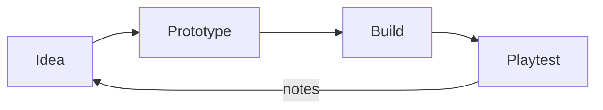
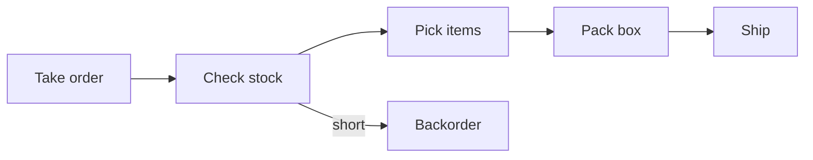
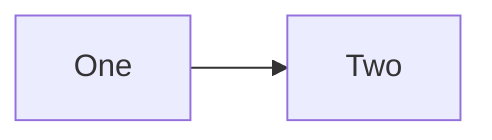

<!-- GENERATED FILE - DO NOT EDIT.
     Produced by `show-your-work render` from intro.md, the .mmd files and their .layout.json sidecars in this directory.
     Edit those and re-run; edits here are overwritten. -->
# Workflow diagrams

## Contents

- [Playtest Feedback](#playtest-feedback) - Four stages from idea to playtest, with playtest feeding back to the idea.
- [Order Fulfilment](#order-fulfilment) - An order is planned, built and shipped, with one rework loop.
- [Plain Diagram](#plain-diagram) - A diagram with no layout sidecar keeps the mermaid path.

---

## Playtest Feedback

Four stages from idea to playtest, with playtest feeding back to the idea.

Source: [`feedback.mmd`](feedback.mmd)

Drawn from:

- `docs/playtest.md`

**Alt (mermaid source):** Four columns left to right; a dashed return runs from the last column back to the first.

**Deliberately not shown:** art, audio

<picture>
  <source media="(prefers-color-scheme: dark)" srcset="rasters/feedback-dark.svg">
  
</picture>

<details><summary>Mermaid source</summary>



</details>

---

## Order Fulfilment

An order is planned, built and shipped, with one rework loop.

Source: [`flow.mmd`](flow.mmd)

Drawn from:

- `docs/fulfilment.md`

**Alt (mermaid source):** Two columns, plan then build, joined by a spine; a dashed return closes the loop.

**Deliberately not shown:** refunds, partial shipments

<picture>
  <source media="(prefers-color-scheme: dark)" srcset="rasters/flow-dark.svg">
  
</picture>

<details><summary>Mermaid source</summary>



</details>

---

## Plain Diagram

A diagram with no layout sidecar keeps the mermaid path.

Source: [`plain.mmd`](plain.mmd)

Drawn from:

- `docs/plain.md`

**Alt:** Two boxes side by side joined by a single arrow.

**Deliberately not shown:** everything else



---

## Regenerating

This file and `workflows.json` are generated from the `*.mmd` sources and `intro.md`.
After editing any of them, run from the project root:

```
show-your-work render docs/workflows
```

The house-style SVGs in `rasters/` are generated from the `*.layout.json` sidecars by the same command.

`show-your-work render docs/workflows --check` writes nothing and exits 1 when this file or `workflows.json` is out of date.
