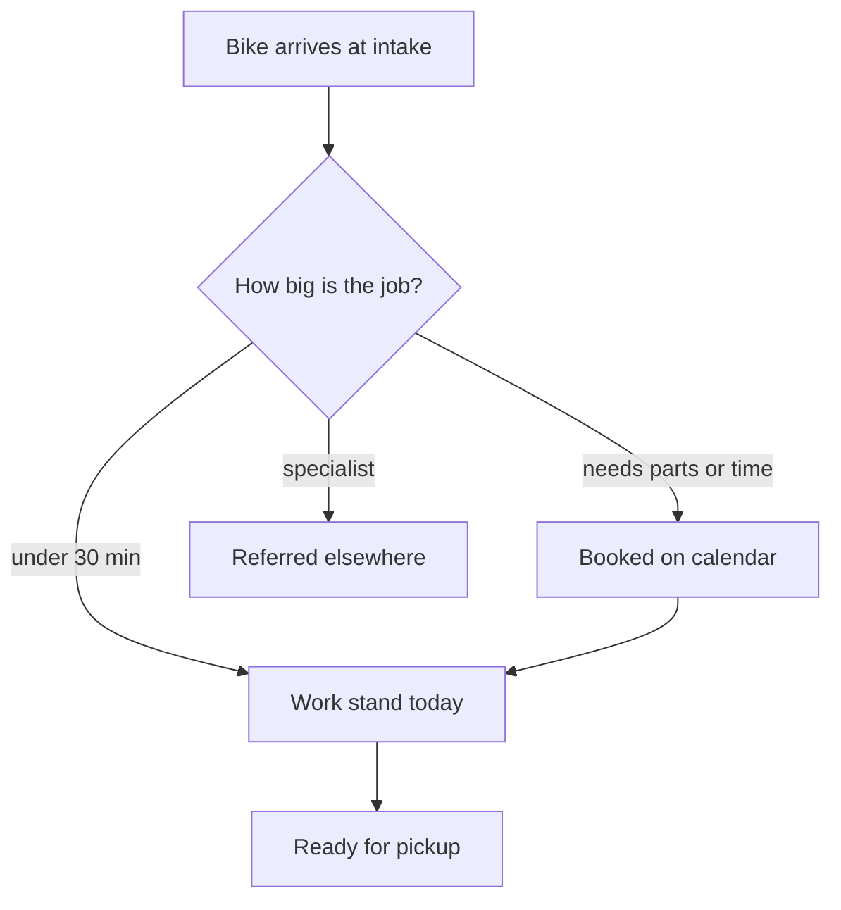
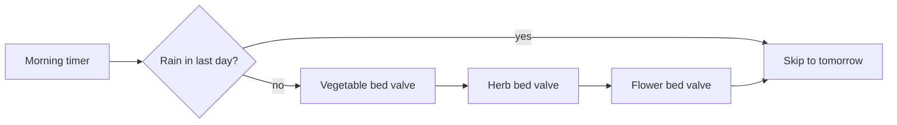
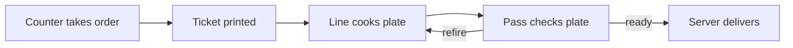
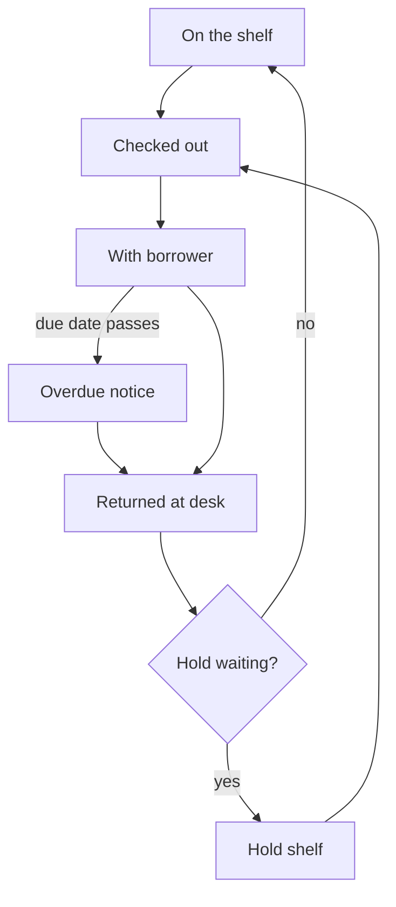
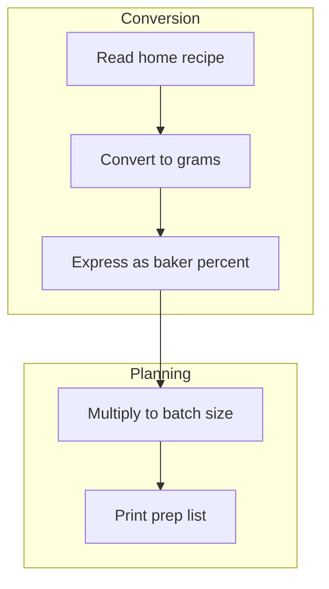

<!-- GENERATED FILE - DO NOT EDIT.
     Produced by `show-your-work render` from intro.md and the .mmd
     files in this directory. Edit those and re-run; edits here are overwritten. -->
# Workflow diagrams

Sample prose for the `realistic` test fixture. Every diagram here is synthetic and on a
generic topic; together they reproduce the header edge cases a real diagram set exhibits.

## Documents

| Document | What it is |
|---|---|
| [kitchen-ticket-flow.mmd](kitchen-ticket-flow.mmd) | A title that contains a colon. |
| [library-loan-lifecycle.mmd](library-loan-lifecycle.mmd) | A title shaped like a label, and unbulleted sources with descriptions. |
| [garden-watering-crlf.mmd](garden-watering-crlf.mmd) | A file saved with CRLF line endings. |
| [bike-repair-triage.mmd](bike-repair-triage.mmd) | A `Not shown:` line of exactly 400 characters. |
| [recipe-scaling-pipeline.mmd](recipe-scaling-pipeline.mmd) | A five-bullet `Sources:` list. |

## Contents

- [Bike Repair Triage](#bike-repair-triage) - How a repair shop sorts incoming bikes into same-day fixes, booked repairs and referrals.
- [Garden Watering Schedule](#garden-watering-schedule) - When the drip system waters each bed, and how a rain sensor skips a cycle.
- [Kitchen Orders: From Ticket to Table](#kitchen-orders-from-ticket-to-table) - How a restaurant order moves from the counter through the line to the pass: one ticket per table.
- [Title: Library Loan Lifecycle](#title-library-loan-lifecycle) - A book's path from the shelf to a borrower and back, including holds and overdue notices.
- [Recipe Scaling Pipeline](#recipe-scaling-pipeline) - Turning a family recipe into a batch plan for a bakery, from unit conversion to the prep list.

---

## Bike Repair Triage

How a repair shop sorts incoming bikes into same-day fixes, booked repairs and referrals.

Source: [`bike-repair-triage.mmd`](bike-repair-triage.mmd)

Drawn from:

- `docs/shop/intake.md`

**Alt:** An intake box splits three ways at a diamond: quick fixes go straight to a work stand, bigger jobs go to a booking calendar, and specialist work leaves the shop.

**Deliberately not shown:** warranty claims, parts ordering and supplier backorders, loaner bike checkout, e-bike battery diagnostics, wheel truing and spoke replacement, suspension servicing, frame crack inspection, custom builds, payment and deposits, customer pickup reminders, weekly tool calibration routine, shop safety walkthroughs, and the seasonal tune-up promotion that changes intake volume for six weeks every spring



---

## Garden Watering Schedule

When the drip system waters each bed, and how a rain sensor skips a cycle.

Source: [`garden-watering-crlf.mmd`](garden-watering-crlf.mmd)

Drawn from:

- `docs/garden/irrigation.md`
- `docs/garden/sensors.md`
- `https://example.com/drip-timer-manual`

**Alt:** A timer box feeds a diamond asking whether rain fell; yes skips to the next day, no opens three bed valves one after another.

**Deliberately not shown:** winterizing, hand watering with a hose, fertilizer injection



---

## Kitchen Orders: From Ticket to Table

How a restaurant order moves from the counter through the line to the pass: one ticket per table.

Source: [`kitchen-ticket-flow.mmd`](kitchen-ticket-flow.mmd)

Drawn from:

- `docs/kitchen/tickets.md`
- `docs/kitchen/expo.md`

**Alt:** Five boxes in a row from counter to table, with a loop from the pass back to the line labelled refire.

**Deliberately not shown:** allergy escalations, comped dishes, split checks



---

## Title: Library Loan Lifecycle

A book's path from the shelf to a borrower and back, including holds and overdue notices.

Source: [`library-loan-lifecycle.mmd`](library-loan-lifecycle.mmd)

Drawn from:

- `docs/library/circulation.md`
- `docs/library/holds.md - how the hold queue is ordered`
- `docs/library/overdue.md - when reminder notices go out`

**Alt:** A loop of boxes from shelf to checkout to borrower to the return desk and back to the shelf, with a side branch through a hold shelf.

**Deliberately not shown:** interlibrary loans, damaged-item fees, staff overrides



---

## Recipe Scaling Pipeline

Turning a family recipe into a batch plan for a bakery, from unit conversion to the prep list.

Source: [`recipe-scaling-pipeline.mmd`](recipe-scaling-pipeline.mmd)

Drawn from:

- `docs/bakery/recipes.md`
- `docs/bakery/units.md`
- `docs/bakery/yield-tables.md`
- `docs/bakery/prep-list.md`
- `https://example.com/baker-percentages`

**Alt:** A top-to-bottom pipeline of five steps grouped in two panels, conversion and planning, ending at a printed prep list.

**Deliberately not shown:** costing, allergen labelling, oven scheduling



---

## Regenerating

This file and `workflows.json` are generated from the `*.mmd` sources and `intro.md`.
After editing any of them, run from the project root:

```
show-your-work render docs/workflows
```

`show-your-work render docs/workflows --check` writes nothing and exits 1 when this file or `workflows.json` is out of date.
